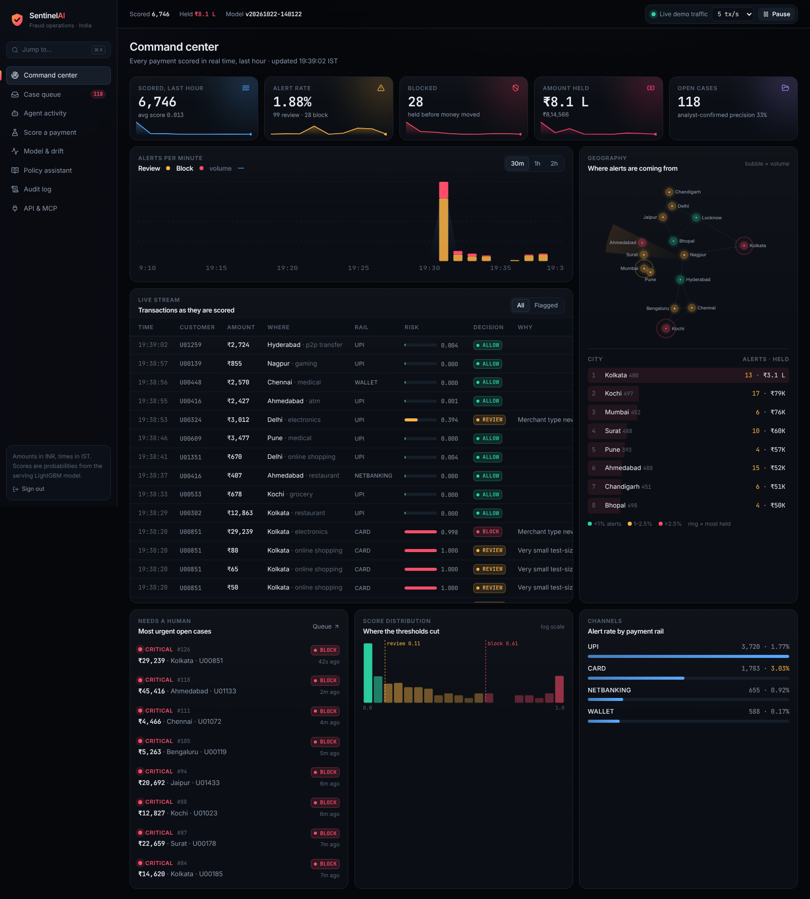
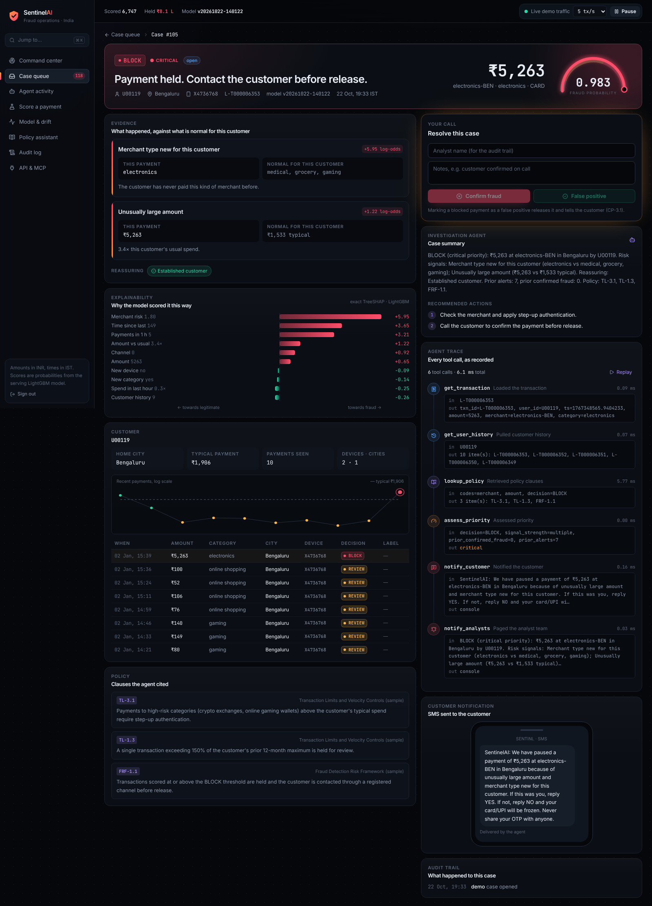
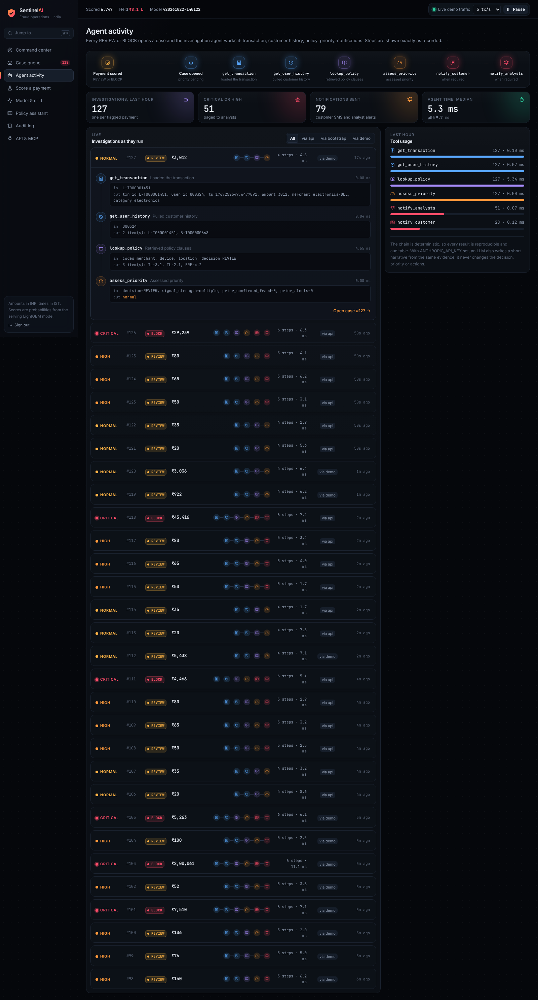
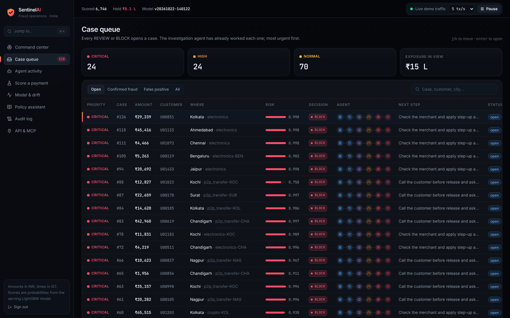
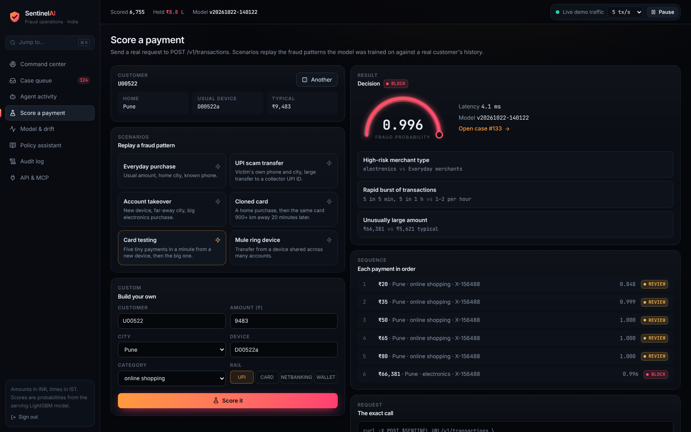

# SentinelAI

Real-time fraud detection, explanation and case management for Indian payments (UPI, cards,
netbanking), with an MCP server so AI agents can operate it.

A payment comes in, SentinelAI scores it in a few milliseconds, decides **ALLOW / REVIEW / BLOCK**,
explains the decision in plain English ("₹1,20,000 vs ₹1,900 typical, from a device never seen before"),
and for anything flagged an investigation agent opens a case, pulls the customer's history, cites the
relevant policy clause, drafts the customer SMS and alerts analysts. Analyst verdicts become training
labels, and a champion/challenger gate decides whether a retrained model ships.



## Measured results

**Public benchmark: ULB credit-card fraud** (284,807 real transactions, 492 frauds). Time-ordered
70/15/15 split so the model never sees the future; thresholds chosen on validation and frozen.

| Model | PR-AUC | Block tier (precision / recall) | Review tier (precision / recall) |
|---|---|---|---|
| Logistic regression baseline | 0.694 | 97% / 63% | 51% / 75% |
| **SentinelAI recipe (LightGBM)** | **0.751** | **97% / 67%** | **57% / 75%** |

Reproduce with `python benchmark/ulb_benchmark.py --csv data/creditcard.csv` (re-run 2026-10-23:
identical numbers).

**How far to trust that table** (`python benchmark/ulb_robustness.py --csv data/creditcard.csv`,
writes `benchmark/ulb_robustness.json`):

* **Wide intervals.** The test period has 52 frauds. Bootstrap 95% intervals: PR-AUC 0.63 to 0.85,
  review precision 44% to 68%, block recall 54% to 80%.
* **Seed 42 is a good draw.** Across five LightGBM seeds PR-AUC is 0.687 to 0.752 (mean 0.723), so
  the gap over the logistic baseline (0.694) is mostly noise.
* **No consistent win over logistic regression.** On four rolling time windows (train on everything
  before, validate on the next 10%, test on the 10% after) LightGBM scores PR-AUC 0.66 / 0.83 /
  0.84 / 0.57 and logistic regression 0.66 / 0.82 / 0.84 / 0.64.
* **Thresholds don't transfer well.** The review threshold targets 85% recall on validation; on the
  rolling windows it lands at 73% to 91% recall while alert volume swings from 20 to 177 per 10k
  payments and precision from 6% to 31%. Block precision ranges from 50% to 100%. With a few dozen
  frauds per window, a frozen threshold is a rough guide, not a guarantee.
* **The product's own settings do worse.** The table uses a tuned recipe. The hyperparameters the
  product actually trains with (`sentinelai/model.py` `PARAMS`) give PR-AUC 0.656 on the same
  split, review tier 28% precision / 75% recall, block tier 73% precision / 69% recall.
* **What this does not test.** ULB is anonymised PCA components of European card payments: no
  customer, device, city or payee, so none of the product's 19 behavioural features (or the
  scenario results below) can be checked on it. It validates the training-and-thresholding recipe
  on real fraud, not the deployed model.

Real versus simulated: the same kind of model reaches PR-AUC 0.92 on the simulator and 0.57 to
0.84 on real card fraud. Expect real-world precision well below the simulated figures below.

**Product model on simulated Indian payment events** (250,000 simulated events, 5 fraud scenarios;
these are not real-world results). Test slice: 37,501 events, 313 frauds.

| Tier | Precision | Recall | Alerts per 10k payments |
|---|---|---|---|
| Review (score ≥ 0.283) | 72% | 87% | 101 |
| Block (score ≥ 0.508) | 87% | 82% | 79 |

PR-AUC 0.92. Share of fraudulent payments caught, by scenario (test frauds in brackets):

| Scenario | Review tier or above | Block tier |
|---|---|---|
| Card testing (150) | 99% | 99% |
| Cloned card (35) | 100% | 100% |
| Mule ring (15) | 100% | 100% |
| Account takeover (37) | 70% | 65% |
| UPI social-engineering scam (76) | 60% | 45% |

Payee features (first transfer to this payee; how many other accounts pay it) carry most of the gain
over the earlier model. On the same events without them, the review tier is 45% precision at 86%
recall with 159 alerts per 10k, and PR-AUC is 0.87. The simulator's payee behaviour (collector
accounts, rotating scam UPI IDs, popular vendors and shared landlords on the legitimate side) was
written alongside these features, so treat the gain as evidence the pipeline learns the signal, not
as a real-world estimate. Scams remain hardest because the victim pays from their own phone at home.
Scenario counts are small: the 95% intervals are about ±11 points for scams and ±15 for takeover,
and 100% on 15 mule frauds only shows the true rate is above roughly 80%. The block column is the model's own decision; payments under ₹500 are
then downgraded to review by the cost layer, so a card-testing burst is reviewed rather than blocked.
Reproduce with `python benchmark/product_eval.py`
(writes `benchmark/product_results.json`).

**Latency** (engine, single thread, including features, TreeSHAP, SQLite write and agent investigation):
p50 2.5 ms, p99 8.2 ms, ~380 transactions/s. Through HTTP: p99 8.7 ms.

## What's in the box

| Capability | Where |
|---|---|
| Feature store (19 behavioural features, same code for training and serving, state persisted) | `sentinelai/features.py` |
| LightGBM model, time-ordered training, threshold selection, versioned registry | `sentinelai/model.py` |
| Exact TreeSHAP contributions → plain-English "this payment vs normal" reasons | `sentinelai/reasons.py` |
| Cost-sensitive decisions (small payments are never hard-blocked; overrides are audited) | `sentinelai/engine.py` |
| Investigation agent with a traced tool chain and optional LLM narrative (Claude, `SENTINEL_LLM_MODEL`, default `claude-opus-5-5`) | `sentinelai/agent.py` |
| Clause-level policy retrieval with citations and abstention | `sentinelai/policy.py` |
| PSI drift monitoring against a reference saved with each model | `sentinelai/drift.py` |
| Champion/challenger retraining with analyst labels | `sentinelai/retrain.py` |
| REST API with API keys, rate limiting, validation, webhook batch ingestion | `sentinelai/api.py` |
| MCP server (8 tools) for Claude Desktop, Claude Code or any MCP client | `sentinelai/mcp_server.py` |
| Web console (React + Vite + Tailwind): command center, case queue, investigation, agent activity, scoring playground, model & drift, policy assistant, audit log | `web/`, `sentinelai/console.py` |
| 32 tests: engine regressions, drift, payee features, policy retrieval eval, API, console, MCP | `tests/` |

## Quick start

```bash
pip install -r requirements.txt
(cd web && npm ci && npm run build)        # builds the console into web/dist (Node 20+)
python -m sentinelai serve --demo          # trains if needed, streams simulated payments
                                           # console on http://localhost:8000, API docs at /docs
pytest -q
```

Sign in with an API key from `SENTINEL_API_KEYS` (local default `dev-key-change-me`). Without
`--demo`, `serve` runs the same API and console with no simulated traffic. To work on the console,
run `npm run dev` in `web/`: Vite serves it on :5173 with hot reload and proxies `/v1` to :8000.

Or with Docker: `cp .env.example .env && docker compose up --build` (set `SENTINEL_DEMO=1` for live
demo traffic).

### The console

| | |
|---|---|
|  |  |
| **Investigation**: verdict, risk gauge, "this payment vs normal" evidence, TreeSHAP chart, agent trace with replay, cited policy, customer SMS, one-click resolution | **Agent activity**: every investigation as it runs, with its tool calls, latency and who triggered it (demo, API, MCP) |
|  |  |
| **Case queue**: priority triage, filters, keyboard navigation (`j`/`k`, `enter`) | **Score a payment**: replay scam, takeover, cloned-card, card-testing and mule scenarios against a real customer |

`Ctrl/⌘ K` opens a command palette (pages, open cases, case numbers); `g` then a letter jumps between pages.

### Deploy

**API on Render.** New → Blueprint → this repo; `render.yaml` builds the Docker image, generates
`SENTINEL_API_KEYS` (read it from the service's Environment tab) and mounts a 1 GB disk for the
database and models. Persistent disks need a paid instance; to try it on the free plan, remove the
`disk` block and set `plan: free` (data then resets on every deploy).

### Score a payment

```bash
curl -X POST localhost:8000/v1/transactions -H "X-API-Key: dev-key-change-me" \
  -H "Content-Type: application/json" \
  -d '{"user_id":"U00042","amount":84000,"city":"Kolkata","device_id":"new-phone","category":"electronics","channel":"upi"}'
```

### Connect an AI agent over MCP

Copy `claude_desktop_config.example.json` into your Claude Desktop config (fix the paths). The agent
gets `score_transaction`, `get_case`, `list_open_cases`, `resolve_case`, `get_user_history`,
`lookup_policy`, `check_drift` and `live_metrics`, all sharing the same database as the console, so
an analyst and an agent work the same case queue.

## Design decisions

- **Benchmark on public data, train on the institution's data.** The ULB features are anonymised,
  so they cannot drive a product that sees raw events. The recipe is proven on ULB; the product model
  trains on each bank's own event schema, bootstrapped with the simulator until labels accumulate.
- **Time-ordered splits everywhere.** Random splits leak future fraud patterns and inflate scores.
- **The model decides risk; a cost layer decides friction.** Below `SENTINEL_MIN_BLOCK_AMOUNT` (₹500)
  a BLOCK becomes REVIEW, because a hard block costs the customer more than the money at risk. Card
  testing is still stopped: the burst is reviewed and the large follow-up payment is blocked.
- **Explanations come from the model**, not a parallel rule set, and are only shown when the
  underlying facts support them (e.g. "rapid burst" requires an actual burst).
- **Deterministic agent, optional LLM.** The investigation chain is reproducible and auditable. An
  LLM, if configured, only writes a narrative from the same evidence; it never changes a decision.
- **SQLite in WAL mode** keeps deployment to one file for a single node. Swap for PostgreSQL when
  scaling horizontally (all SQL is in `engine.py` and `db.py`).

## Limitations (read before any real use)

- `policies/` contains **illustrative sample policies**, not official RBI, FIU-IND or NPCI text.
  Replace them with your institution's approved documents.
- The product model is trained on **simulated** events. Real deployment needs the institution's
  labelled history; metrics will differ.
- Policy retrieval is lexical (TF-IDF with synonyms). On the 12 questions used to calibrate it,
  11 are handled correctly (one gets a low-confidence "possible match" instead of abstaining). On 16
  held-out paraphrases it handles only 6, mostly by hedging or abstaining on questions it should
  answer. Across both sets every high-confidence answer was correct. It does not understand
  paraphrases the way an embedding model would.
- Review-tier precision is about 72% on simulated data, so roughly 3 in 10 review alerts are
  still false alarms. Payee features need the beneficiary (UPI ID) on each transfer; without it
  the payee defaults to the merchant and those two features stay at zero.
- Drift is measured against the training data. Time-of-day features are only compared once the
  window covers a full day, and customer history only flags a rise in cold-start customers, since
  it otherwise just tracks how long customers have been with the bank. `python -m sentinelai simulate`
  and the console first replay ~90,000 events into customer histories (without scoring them), so
  demo traffic resembles the training population.
- No customer-facing reply handling (the YES/NO in the SMS), SSO for analysts, or PII encryption at
  rest yet. See `docs/ARCHITECTURE.md` for the roadmap.

## Project layout

```
sentinelai/     core package (engine, features, model, agent, policy, drift, API, MCP)
web/            web console (React, TypeScript, Vite, Tailwind), served by the API at /
policies/       Markdown policy documents indexed by clause ID (samples)
benchmark/      ULB benchmark, product-model evaluation and results
tests/          pytest suite
docs/           architecture and model card
```

Licence: MIT. Dataset licence for the benchmark: ULB Credit Card Fraud, Open Database License.
