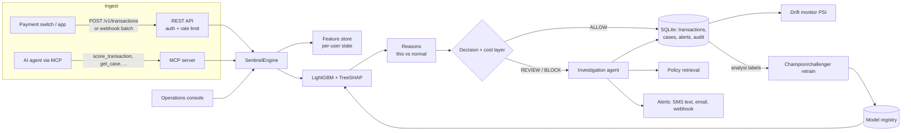

# Architecture

## Request path (one payment)

1. Validate input (Pydantic) and authenticate the API key; token-bucket rate limit per key.
2. Feature store computes 17 features from the customer's persisted state (typical spend,
   devices, cities, recent activity) and records context for explanations.
3. LightGBM returns a probability and exact TreeSHAP contributions in one call.
4. Thresholds from the model card map probability to ALLOW / REVIEW / BLOCK; the cost layer
   downgrades low-value BLOCKs and records why.
5. The transaction, features, contributions and reasons are persisted; customer state is updated.
6. REVIEW/BLOCK opens a case and runs the investigation agent synchronously (sub-millisecond tools):
   history → policy lookup → priority → actions → notifications, with every step traced.

## Feedback loop

Analysts resolve cases in the console, API or via MCP. Labels are stored on the transaction and
weighted 3× in the next training run. `retrain` trains a challenger on fresh data plus labels,
evaluates both models on the same recent slice, and promotes only if PR-AUC improves by ≥ 0.003
without losing more than 1 point of review recall. The previous model stays in the registry for rollback.

## Roadmap to a bank pilot

| Area | Next step |
|---|---|
| Data | Train on the pilot bank's labelled history; add merchant-level and beneficiary-level features |
| Retrieval | Embedding retrieval for paraphrased policy questions, keeping clause citations |
| Security | Analyst SSO, role-based access, PII encryption at rest, key rotation |
| Scale | PostgreSQL, Redis-backed feature state, horizontal API workers |
| Customer loop | Handle SMS/app YES/NO replies and feed them back as labels |
| Governance | Scheduled drift job, model-risk sign-off workflow before promotion |
